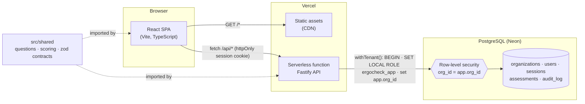

# ErgoCheck

[](https://github.com/Aesedai/ergocheck/actions/workflows/ci.yml)

A small **multi-tenant workplace ergonomic self-assessment** app. Employees answer twelve quick questions about their chair, screen, keyboard, breaks and any discomfort, and get a risk score with specific guidance. Organization admins see an aggregate view of **their own organization only** — participation, where risk concentrates, and an audit trail — without access to any individual's answers.

It's a portfolio project built end to end: React + TypeScript front end, a typed Fastify API, PostgreSQL with checked-in migrations and row-level security, cookie sessions, role-based access, an append-only audit log, and a CI-gated pull-request workflow.

**Live demo: [ergocheck-demo.vercel.app](https://ergocheck-demo.vercel.app)**

| Demo account | Role | Organization |
|---|---|---|
| `alex@harborpine.example` | Member | Harbor & Pine Insurance |
| `dana@harborpine.example` | Org admin | Harbor & Pine Insurance |
| `luis@cobaltfreight.example` | Org admin | Cobalt Freight Co. |

Password for all demo accounts: `ergocheck-demo`. Organizations and people are fictional.

---

## Architecture



**Request path for a tenant-scoped call** (e.g. `GET /api/admin/summary`):

1. `requireAuth` hashes the session cookie, looks up the session → user → org. The tenant comes **only** from the session — no endpoint accepts an org id.
2. `requireRole('org_admin')` (where applicable) — RBAC is enforced on the server; the UI just hides links.
3. `withTenant(ctx, fn)` opens a transaction, switches to the restricted `ergocheck_app` role, and sets `app.org_id`. Every query inside runs under Postgres row-level security.
4. Repository functions also filter by `org_id` explicitly; the audit event is written in the same transaction.

| Layer | Tech |
|---|---|
| Front end | React 19, React Router, TypeScript, Vite, hand-rolled CSS |
| API | Fastify 5, zod validation, `@fastify/cookie` |
| Database | PostgreSQL 16 (Neon in production, Docker locally), plain SQL migrations |
| Auth | Server-side sessions (opaque token in httpOnly cookie, SHA-256 at rest), bcrypt |
| Tests | Vitest — unit (scoring), API (Fastify inject), and DB (RLS) against real Postgres |
| CI | GitHub Actions: lint → typecheck → test → build, Postgres service container |
| Hosting | Vercel (Build Output API: static SPA + one bundled Node function) |

## Engineering notes

### Tenant isolation is enforced in the database
An app-layer `WHERE org_id = ?` is necessary but not sufficient — one missed filter leaks another customer's data. So isolation is layered:

- **Row-level security** on `assessments` and `audit_log`, comparing `org_id` with a per-transaction setting. `FORCE ROW LEVEL SECURITY` binds the table owner too.
- **Restricted role.** Tenant transactions run `SET LOCAL ROLE ergocheck_app`, so RLS applies even when the connection user is a superuser (local Docker, CI).
- **Composite foreign key** `(user_id, org_id) → users(id, org_id)`: an assessment physically can't reference a user from a different org.
- **Explicit filters in every repository query** as well, so intent is visible in code review.
- **No tenant parameter** on any endpoint, and **404 rather than 403** for other tenants' records so ids can't be probed.

The tests prove it at both levels: [`tests/tenant-isolation.db.test.ts`](tests/tenant-isolation.db.test.ts) issues deliberately *unfiltered* queries as org A and asserts org B's rows are invisible, un-updatable, un-deletable and can't be inserted; [`tests/assessments.api.test.ts`](tests/assessments.api.test.ts) and [`tests/admin.api.test.ts`](tests/admin.api.test.ts) check the same through the HTTP API. All of it runs in CI on every PR.

### RBAC and data minimization
Two roles: `member` and `org_admin`. Admins get **aggregates only** — participation, risk distribution by each person's latest assessment, average risk by area, monthly activity. Individual assessments include self-reported discomfort, which is personal health information, so they are visible **only to the person who took them** — admins included. A test asserts the admin summary contains no emails, user ids or answers.

### Server is authoritative
The question set, the answer schema and the scoring function live in `src/shared` and are used by both the form and the API — one definition, no drift. But the server **re-validates and re-scores** every submission; the schema is `.strict()`, so a client-supplied `totalScore` is rejected with a 400.

### Append-only audit trail
`audit_log` records logins (and failed logins), logouts, assessment create/view and admin views — who and what, never assessment content. The app role has only `INSERT`/`SELECT`, and a trigger rejects `UPDATE`/`DELETE` for every role including the owner. Events are written in the same transaction as the action they describe.

### Sessions
Opaque 256-bit tokens in an `httpOnly`, `SameSite=Lax`, `Secure` (in production) cookie; only the SHA-256 is stored, sessions expire after 8 hours and are deleted on logout. Unknown emails and wrong passwords return the same 401 and take the same bcrypt time. Mutating endpoints accept only JSON, which a cross-site form can't send without a CORS preflight.

### Deliberately out of scope
Password reset, SSO, email, rate limiting, small-cohort suppression on the admin dashboard, and multi-region concerns — each would be next in a production build.

## Running locally

Requires Node 22+ and Docker.

```bash
docker run -d --name ergocheck-pg -e POSTGRES_PASSWORD=postgres -e POSTGRES_DB=ergocheck \
  -p 127.0.0.1:5432:5432 postgres:16-alpine
cp .env.example .env
npm ci
npm run db:seed        # runs migrations, then loads the demo orgs, people and assessments
npm run dev:api        # API on :3001
npm run dev:web        # app on http://localhost:5173 (proxies /api)
```

```bash
npm run lint
npm run typecheck
npm test               # uses a separate ergocheck_test database, created automatically
npm run build:vercel   # production build into .vercel/output
```

## Project layout

```
db/migrations/        plain SQL, applied in order and tracked in schema_migrations
src/shared/           question definitions, scoring, zod request/response contracts
src/server/           Fastify app, auth, withTenant(), audit, repositories, routes
src/web/              React SPA: pages, components, typed API client
scripts/              migrate, seed, Vercel build
tests/                unit, API and database tests (Vitest)
```

## How this repo was built

`main` is protected: changes land only through pull requests that pass CI (lint, typecheck, tests against Postgres, build), are squash-merged, and have their review conversations resolved. Each unit of work is its own branch and PR — [browse the closed PRs](https://github.com/Aesedai/ergocheck/pulls?q=is%3Apr+is%3Aclosed) for the description, test plan and review history of each.

## License

[MIT](LICENSE)
